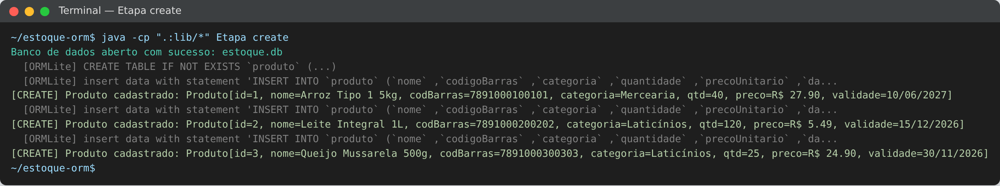
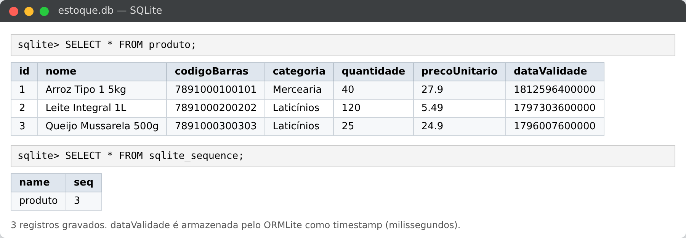
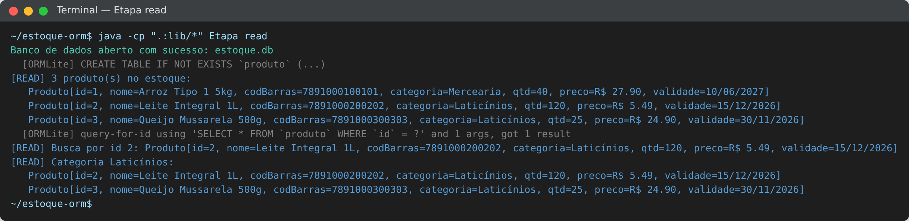
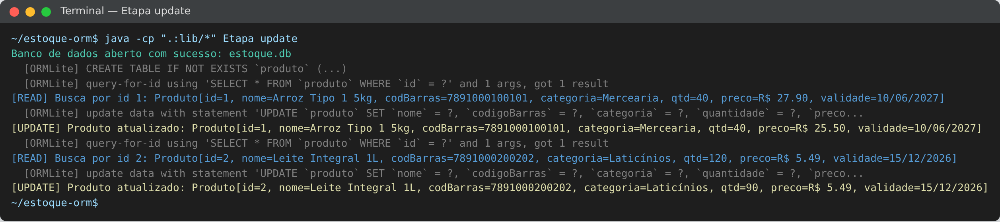
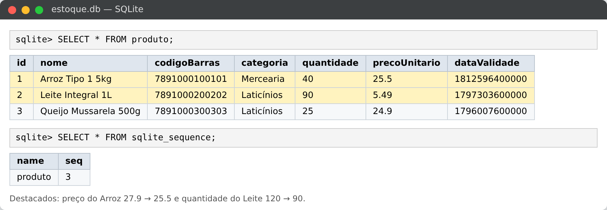
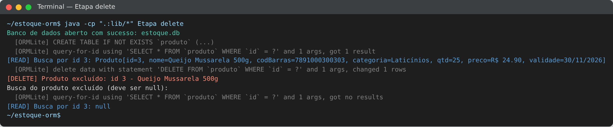
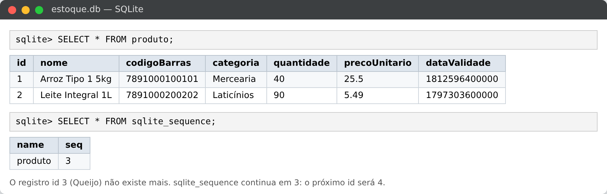
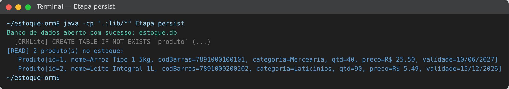

# Persistência de Dados com ORM e CRUD — Estoque de Supermercado

**Aluno:** Ian Nascimento Santos Costa e Souza — Matrícula 202600670
**Curso:** Engenharia de Computação — UFG

Atividade prática de Mapeamento Objeto-Relacional (ORM) com **Java + ORMLite + SQLite**, seguindo o padrão *Repository* do [tutorial de ORM](https://github.com/marceloakira/tutorials/blob/main/orm/README.md). O tema acompanha o trabalho em grupo: **controle de estoque de um supermercado**.

---

## 1. Classe escolhida: `Produto`

A entidade `Produto` representa um item do estoque do supermercado e é mapeada para a tabela `produto` no banco SQLite (`estoque.db`).

| Atributo        | Tipo Java | Anotação ORMLite                     | Descrição                         |
|-----------------|-----------|--------------------------------------|-----------------------------------|
| `id`            | `int`     | `@DatabaseField(generatedId = true)` | Chave primária autoincrementada   |
| `nome`          | `String`  | `@DatabaseField(canBeNull = false)`  | Nome do produto (obrigatório)     |
| `codigoBarras`  | `String`  | `@DatabaseField`                     | Código de barras (EAN)            |
| `categoria`     | `String`  | `@DatabaseField`                     | Ex.: Mercearia, Laticínios        |
| `quantidade`    | `int`     | `@DatabaseField`                     | Unidades disponíveis em estoque   |
| `precoUnitario` | `double`  | `@DatabaseField`                     | Preço de venda                    |
| `dataValidade`  | `Date`    | `@DatabaseField(dataType = DataType.DATE)` | Data de validade            |

A classe é anotada com `@DatabaseTable(tableName = "produto")`, o que faz o ORMLite criar e usar essa tabela sem que seja preciso escrever SQL.

## 2. Implementação

O projeto tem quatro classes:

- **`Database`** — abre e fecha a conexão `JdbcConnectionSource` com o arquivo SQLite (igual ao tutorial).
- **`Produto`** — a entidade (POJO) com as anotações de mapeamento, getters e setters.
- **`ProdutoRepository`** — implementa o padrão *Repository*. Cria o `Dao<Produto, Integer>` com `DaoManager` e a tabela com `TableUtils.createTableIfNotExists`. Os métodos `update` e `delete`, deixados como `TODO` no tutorial, foram implementados.
- **`TesteCRUD`** — método `main` que executa as quatro operações em sequência.
- **`Etapa`** — executa uma operação por vez (`create`, `read`, `update`, `delete`, `persist`); foi usada para gerar as evidências.

| Operação   | Método no repositório                         | Método do Dao usado              |
|------------|-----------------------------------------------|----------------------------------|
| **Create** | `create(Produto)`                             | `dao.create()`                   |
| **Read**   | `loadFromId(int)`, `loadAll()`, `loadByCategoria(String)` | `dao.queryForId()`, `dao.queryForAll()`, `dao.queryForEq()` |
| **Update** | `update(Produto)`, `movimentarEstoque(int, int)` | `dao.update()`                |
| **Delete** | `delete(Produto)`, `deleteById(int)`          | `dao.delete()`                   |

O método `movimentarEstoque` é uma regra de negócio do tema: registra entrada (valor positivo) ou saída/venda (valor negativo) de unidades, impedindo estoque negativo.

### Bibliotecas (adicionadas em BlueJ > Preferências > Bibliotecas)

- sqlite-jdbc-3.46.0.0.jar
- ormlite-core-6.1.jar
- ormlite-jdbc-6.1.jar
- slf4j-api-2.0.13.jar
- slf4j-simple-2.0.13.jar

---

## 3. Testes e evidências

Para gerar as evidências, cada operação foi executada **em um processo Java separado** pela classe `Etapa` (`java Etapa create`, `read`, `update`, `delete`, `persist`). Como cada execução abre uma nova conexão, os dados de uma etapa só aparecem na seguinte porque foram salvos no arquivo `estoque.db`, e não apenas na memória.

Nos prints do terminal, as linhas em cinza marcadas com `[ORMLite]` são o log do próprio ORM e mostram o SQL que ele gerou automaticamente (`INSERT`, `SELECT`, `UPDATE`, `DELETE`). O código não contém nenhuma linha de SQL escrita à mão. Depois de cada etapa, o conteúdo do arquivo `estoque.db` foi consultado diretamente no SQLite.

### 3.1 Create — cadastro de produtos

Foram cadastrados três produtos: *Arroz Tipo 1 5kg*, *Leite Integral 1L* e *Queijo Mussarela 500g*. Na primeira execução, o ORMLite cria a tabela `produto`. Após cada `create`, o objeto recebe o `id` gerado pelo banco (1, 2 e 3).

**Evidência no banco:** a tabela `produto` contém as três linhas, e a tabela `sqlite_sequence` registra 3 como o último id gerado. A coluna `dataValidade` é armazenada pelo ORMLite como timestamp, em milissegundos.

### 3.2 Read — consulta por id e listagem

Em um novo processo, `loadAll()` retorna os três produtos, `loadFromId(2)` retorna somente o Leite e `loadByCategoria("Laticínios")` retorna o Leite e o Queijo.

### 3.3 Update — atualização de produto

O preço do Arroz foi alterado de R$ 27,90 para R$ 25,50 com `update()`. Também foi registrada a venda de 30 unidades de Leite com `movimentarEstoque(2, -30)`, e a quantidade passou de 120 para 90.

**Evidência no banco:** as linhas destacadas mostram os novos valores de `precoUnitario` e `quantidade`.

### 3.4 Delete — exclusão de produto

O Queijo Mussarela (id 3) foi excluído com `delete()`. Em seguida, `loadFromId(3)` retorna `null`, o que comprova que o registro não existe mais.

**Evidência no banco:** a tabela `produto` passa a ter apenas duas linhas. A tabela `sqlite_sequence` continua em 3, então o próximo produto cadastrado receberá o id 4.

### 3.5 Persistência

Uma última execução independente de `loadAll()` traz exatamente o estado final: o Arroz com o novo preço e o Leite com 90 unidades. Os dados sobreviveram ao fim de todos os processos anteriores, porque estão gravados no banco.

